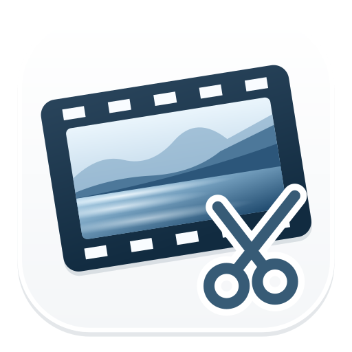

# cygnus movies



**必要な場面を切り出して、複数の動画に書き出し。軽くてシンプルで高速なmacOS用動画編集アプリです。**

## ダウンロード・インストール

**[最新版をダウンロードする（配布ページ）](https://github.com/pen2/cygnus-movies/releases/latest)**

**[v1.8.0のZIPを直接ダウンロード](https://github.com/pen2/cygnus-movies/releases/download/v1.8.0/cygnus-movies-1.8.0-macOS-universal.zip)** · 約2.7MB · macOS 13以降 · Apple silicon / Intel両対応

1. ZIPをダウンロードして、ダブルクリックで展開します。
2. **cygnus movies.app** を「アプリケーション」フォルダにドラッグします。
3. アプリを起動し、MOV・MP4の動画や画像を素材欄にドロップして編集を始めます。

Finderで素材を右クリックし、「このアプリケーションで開く」→「cygnus movies」を選んでも読み込めます。起動していない場合は、指定した素材だけを読み込んで起動します。起動済みの場合は現在のプロジェクトへ追加します。複数ファイルにも対応しています。素材はまず素材欄に入り、タイムラインへの配置は手動で行います。

配布版はDeveloper IDで正式署名し、Appleの公証を受けています。初回起動時は、インターネットからダウンロードしたアプリを開くかどうか、macOS標準の確認が表示される場合があります。

## どんなアプリ？

cygnus moviesは、動画や画像をタイムラインに並べ、カット・テロップ・部分ぼかしなどを加えて書き出せる、Mac向けの動画編集アプリです。シンプルな画面に必要な操作をまとめ、日本語と英語に対応しています。

高速に起動し、プロジェクトを保存せずとも書き出しまで行えるため、ササッと動画を編集して作業を終わらせられます。プロジェクトファイルもシンプルなjsonであるため、とても軽量です。

ひとつのプロジェクトに複数のタイムラインを作れるため、同じ素材から短い動画を何本も作ったり、横・縦・正方形のバリエーションを作ったりする作業に向いています。

商業利用も可能です。

## 長所

- **小さな配布サイズ**：Intel / Apple silicon両対応でも、配布ZIPは約2.7MB。動画処理にはmacOS標準のAVFoundationを使用し、外部のFFmpegや大きな変換エンジンを同梱しません。
- **対応Macでは高速な書き出し**：ハードウェアエンコーダーを優先して利用します。設定でオフにでき、利用できない場合はソフトウェアへ切り替えます。実際に使用した方式は書き出し状況で確認できます。速度は素材・効果・出力設定・Macの機種によって異なります。
- **ひとつの素材から複数の完成動画へ**：複数タイムラインを使い分け、まとめて書き出せます。タイムライン間の項目の移動・複製、新規タイムラインを作成しての移動・複製、名前の一括変更、書き出し名の連番にも対応します。
- **素材を複製せずに編集**：プロジェクトには編集内容と元ファイルの参照を保存します。元の動画や画像を変更せず、素材の複製による容量の増加を抑えます。
- **横・縦の混在に対応**：画面比率に合わない余白を、黒または素材を拡大したぼかし背景で埋められます。

## 主な機能

| 分類 | 機能 |
| --- | --- |
| 素材 | MOV・MP4・画像の読み込み、クリップボードからの一時素材追加、サムネイル表示、一覧からの取り除き、素材の再指定 |
| プレビュー | 大きな再生ボタン、Spaceで再生・停止、左右キーで1コマ送り、効果込みフレームの画像コピー・共有 |
| 基本編集 | クリップの移動・トリミング・分割・複製・削除、取り消し・やり直し、Shiftによる複数選択 |
| タイムライン | 複数タイムライン、タイムライン間の移動・複製、吸着、ズーム、全尺表示、ドラッグ先の目印 |
| レイヤー | テキスト・画像・矩形・部分ぼかし・モザイク。時間範囲、表示位置、大きさ、重なり順を編集 |
| テキスト | フォント・太字・文字色・縁取り色・影、文字サイズ（pt）・縁取り幅（px）の直接入力、左・中央・右揃え |
| 画像・矩形 | 透過PNGなどのアルファチャンネル、矩形の色・不透明度、静止画クリップと画像オーバーレイ |
| 効果 | フェードイン・アウト、クロスディゾルブ、左右からのスワイプ、黒背景・拡大ぼかし背景 |
| 色・速度 | 明るさ・ホワイトバランス・ガンマ・彩度・色相、10〜800％の再生速度、速度変更時の音程保持 |
| 音声 | 波形表示のオン・オフ、クリップごとの音量変更・無音化 |
| 出力 | FHD・4K、16:9・9:16・1:1、30・60 fps、MOV・MP4、H.264・HEVC（H.265） |
| 色・音声の出力 | SDR（Rec.709）・HDR（HEVC 10-bit HLG）、AAC・音声なし、MOVではApple Lossless・リニアPCMも選択可能 |
| 設定・保存 | 最初の動画から解像度・画面比率・fpsを自動選択、プロジェクト保存、タイムスタンプ付きの書き出し名 |
| 操作案内 | 右クリックメニュー、アプリ内ヘルプ、日本語・英語表示、OS設定に従う言語選択 |

正方形の出力サイズは1080×1080または2160×2160です。HDRやハードウェアエンコードの利用可否はMacの機種・OS・出力設定に依存します。

吸着・音声波形の表示・ズーム倍率はアプリ共通の設定です。タイムラインやプロジェクトを切り替えても維持され、アプリの再起動後も保存されます。「全尺を表示幅に合わせる」で選んだ表示スケールも他のタイムラインに引き継ぎます。

複数書き出しでは、各動画の進捗に加えて全体の進捗を表示します。アプリのタイトルバーでも全体の進捗を確認できます。

クリップボードから追加した一時素材は「一時素材・保存対象外」と表示され、アプリ終了時に破棄されます。プロジェクト保存では一時素材と、その素材を使ったクリップ・画像レイヤーが除外されます（保存前に確認を表示します）。書き出した動画には一時素材も反映されます。画像・動画ファイルをコピーした場合も、独立した一時コピーとして扱います。継続して編集したい素材は、通常のファイルとして読み込んでください。

## 動作環境

- **macOS 13 Ventura以降**
- **Apple silicon搭載Mac、またはIntel搭載Mac**（配布版はUniversal Binary）
- 素材の読み込みと書き出しに必要な空き容量

両CPU向けにビルドし、アプリ本体の最低対応OSが13.0であることを確認しています。現在のApple silicon環境で編集・書き出しを検証していますが、macOS 13搭載機とIntel実機での動作確認は未実施です。

## 使い始めるには

1. 動画や画像を素材欄へ読み込み、タイムラインへ追加します。
2. クリップの両端でトリミングします。再生位置で **B** を押すと、その位置をまたぐクリップとレイヤーを分割します。
3. 必要に応じて「レイヤーを追加」からテキストやぼかしなどを配置します。
4. 右ペインで出力設定を選び、「書き出し」から完成動画を保存します。

**⌘Z** で取り消し、**⇧⌘Z** でやり直し、**Delete** で選択項目を削除できます。詳しい使い方はアプリの「ヘルプ」をご覧ください。

プロジェクト（`.cygnusmovies`）には元の動画・画像は含まれません。素材を移動・削除すると参照が切れるため、プロジェクトとともに素材も保管してください。素材欄から取り除く操作では、元ファイルは削除されません。

## ソースからビルド

Xcodeと、そのコマンドラインツールが必要です。Swift Packageとして構成しています。

```sh
DEVELOPER_DIR=/Applications/Xcode.app/Contents/Developer \
./build-app.sh --universal --disable-sandbox --build-system native
```

`dist/cygnus movies.app` が作成されます。このビルドは開発用の仮署名です。配布用の署名・公証の手順は [RELEASE.md](RELEASE.md) を参照してください。証明書・秘密鍵・認証情報はリポジトリに含まれません。

## 制作・ライセンス

制作：[cygnus2](https://cygnus2.jp/)

[MIT License](LICENSE)。不具合や要望は [Issues](https://github.com/pen2/cygnus-movies/issues) へお寄せください。
